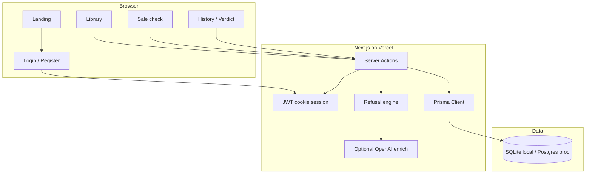

# Don’t Wishlist — Architecture

## System diagram



## Request flow — sale check

```text
1. Authenticated user posts candidates
2. Load library + recent verdicts
3. runRefusalEngine() scores each candidate (deterministic)
4. maybeEnrichWithLlm() if OPENAI_API_KEY set
5. Persist SaleCheck JSON
6. Redirect to /checks/[id]
7. User marks correct / wrong / too_safe
8. Regenerate creates a new SaleCheck biased by verdicts
```

## Why this shape

- **Rules engine first** — demo works without an LLM key (reviewers can click immediately)
- **Verdicts as evals** — tiny human feedback loop Casper can dig into
- **Single Next.js deploy** — Vercel-friendly, TypeScript end-to-end

## Staff-level demo touches (uncommon in take-homes)

1. **Content-addressed fingerprint** — SHA-256 of library + candidates + verdicts (`inputFingerprint`). Regenerate and watch it change; proves the loop isn’t cosmetic.
2. **Online eval strip** — precision from human `correct`/`wrong` marks on History (`EvalStrip`).
3. **Score autopsy ledger** — each refusal exposes weighted contributions (`DecisionAutopsy`), not a black-box paragraph.
4. **Dollars refused receipt** — sum of sale prices you didn’t spend (`ProvenanceBar`).

## Rendering model

| Surface | Strategy |
|---|---|
| Auth’d pages | `force-dynamic` RSC + `Promise.all` data loaders |
| Auth | `React.cache(requireUser)` request dedupe |
| Covers | `next/image` → `/api/cover` (deterministic SVG, cached) |
| Heavy UI | Client islands only (`LibraryList`, `DecisionAutopsy`, forms) |
| Domain | Zod schemas as single source of truth |

## CI / Docker control plane

```text
PR / push
  → lint + tsc --noEmit
  → vitest (unit + prisma integration + coverage gates)
  → docker compose build
  → healthcheck must become healthy
  → scripts/smoke.mjs against the container
  → only then is the image considered shippable
```
